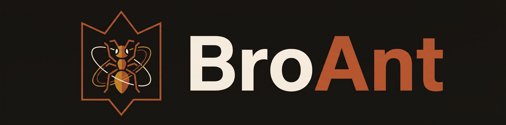

<div align="center">
  <picture>
    <source media="(prefers-color-scheme: dark)" srcset="public/brand/banner-dark.png">
    <source media="(prefers-color-scheme: light)" srcset="public/brand/banner-light.png">
    
  </picture>
</div>

# BroAnt 🐜

> **Hardworking AI Browser Worker & Native MCP Bridge**  
> *Local-First Headful AI Browser Runtime for Claude Code, Cursor, Antigravity, and Local LLMs.*

[](LICENSE)
[]()
[]()
[]()

---

## 🌟 What is BroAnt?

**BroAnt** (Browser + Worker Ant 🐜) turns your everyday Google Chrome into an industrious, autonomous browser runtime for external AI coding assistants and local LLMs.

Unlike headless tools (Playwright/Puppeteer) that launch empty profiles and trigger anti-bot challenges, BroAnt works directly inside your **real, authenticated browser sessions**. External AI agents can inspect pages, fill forms, click buttons, take screenshots, and run autonomous tasks through a standardized **Model Context Protocol (MCP)** server.

---

## ⚡ Core Capabilities

### 1. Native MCP Server (`broant-mcp`)
- **10 Core Browser Tools**:
  - `browser_navigate`: Navigate active or new tabs cleanly.
  - `browser_click`: Click, double-click, hover, press Enter, or focus interactive elements using element refs (`ref: "e12"`).
  - `browser_fill`: Single or multi-field form completion (`fields: { e1: "user", e2: "pass" }`).
  - `browser_observe`: Accessibility-tree DOM snapshot with interactive refs.
  - `browser_read`: Extract text content or articles with pagination offsets (`tab_id` supported).
  - `browser_screenshot`: Multimodal vision returning native MCP image content (`ref` crop, `full_page`, bounding box `labels`, `tab_id` supported).
  - `browser_upload`: Attach local files to `<input type="file">` elements (opt-in via Settings → Agent Bridge → **Allow File Uploads**).
  - `browser_list_tabs`: Query open tabs and active debugging sessions.
  - `browser_close_session`: Detach CDP debugger cleanly.
  - `browser_run_agent_task`: Delegate complex, multi-step autonomous browsing tasks.
- **Resource `browser://tabs`**: Instant list of open tabs and debugging sessions without burning LLM tool turns.

### 2. Auto-Electing Hub (`127.0.0.1:8765`)
- Run multiple IDE instances simultaneously (Cursor + Claude Code + Antigravity) with zero `EADDRINUSE` conflicts.
- First process auto-elects as **Leader**; subsequent processes automatically connect as **Relays**.
- Automatic leader re-election with random jitter if the active Leader terminates.

### 3. Real Browser Sessions — Zero Bans & No Captchas
- Operates inside your existing Chrome window with all your active logins (Google, GitHub, trading portals, internal VPN intranets).
- Bypasses Cloudflare Turnstile and bot-checks naturally without fake fingerprints.

### 4. Local LLM Optimization & Zero-Tool Recipes
- **Smart DOM Pruning**: Prunes noise attributes, repetitive lists, and SVG bloat to compress page representation under 14,000 characters.
- **Compact Tool Mode & KV-Cache Preservation**: Automatically trims rarely used tools (`LOCAL_COMPACT_OFF`) and delays context elision (`0.85 × threshold`) for local servers (LM Studio, Ollama) to preserve prompt prefix caching.
- **Zero-Tool Recipes**: Deterministic 1-click pipelines (`extract → llm → act/notify`) without tool-schema overhead, including built-in `/summarize-fast`, `/extract-table`, and `/draft-reply` actions.

### 5. Floating Mini-Rail HUD, Page Monitors & Safety
- **Floating Mini-Rail HUD**: Shadow-DOM overlay on web pages with 1-click Quick Actions, `+ Watch this page`, DOM pruning toggle (`14k` / `standard`), and live MCP/Agent status LEDs.
- **Background Page Monitors**: Scheduled `chrome.alarms` watchers using line-diff detection (`diffLines`) that skip LLM calls when page content has not changed.
- **Visual Safety & Hardened Permissions**: Border indicators on tabs under active MCP control, nonce-bounded untrusted content isolation, opt-in file uploads (`bridgeAllowFileUploads: false` by default), and a persistent 200-entry Diagnostic Log viewer in Settings → Data (with analytics disabled by default).

---

## 🚀 Quick Start

### 1. Build & Load the Extension
```bash
# Clone the repository
git clone https://github.com/Steppenwoolf/broant.git
cd broant

# Install dependencies and build extension
pnpm install --no-engine-strict
pnpm run build
```
1. Open Chrome and go to `chrome://extensions/`.
2. Turn ON **Developer mode** (top right).
3. Click **Load unpacked** and select the `dist/` directory.

### 2. Enable Agent Bridge
1. Open BroAnt Settings → **Agent Bridge**.
2. Switch **Agent Bridge** ON (default port: `8765`).
3. Click **Copy Config** to copy your tailored MCP setup with your unique token.

### 3. Connect Your AI Assistant

Add BroAnt to your AI client configuration:

#### Claude Desktop / Claude Code (`claude_desktop_config.json`)
```json
{
  "mcpServers": {
    "broant": {
      "command": "npx",
      "args": ["-y", "broant-mcp"],
      "env": {
        "BROANT_BRIDGE_TOKEN": "your-auth-token-from-settings"
      }
    }
  }
}
```

#### Cursor (`.cursor/mcp.json`)
```json
{
  "mcpServers": {
    "broant": {
      "command": "npx",
      "args": ["-y", "broant-mcp"],
      "env": {
        "BROANT_BRIDGE_TOKEN": "your-auth-token-from-settings"
      }
    }
  }
}
```

---

## 🏗️ Monorepo Structure

```text
broant/
├── packages/
│   └── mcp/                  # Standalone MCP server package (broant-mcp)
│       ├── src/
│       │   ├── bridge-hub.ts # Auto-Electing Leader/Relay WebSocket Hub
│       │   ├── cli.ts        # CLI entrypoint & stdio transport
│       │   ├── protocol.ts   # Protocol definitions, token auto-gen & auth guards
│       │   └── server.ts     # 10 MCP tools & browser://tabs resource
│       └── package.json
├── src/
│   ├── bridge/               # Extension-side Bridge client & dispatcher
│   ├── browser-control/      # CDP controller, DOM pruning & perception
│   ├── extension/            # Chrome MV3 background service worker
│   ├── options/              # Settings & Agent Bridge configuration UI
│   └── side-panel/           # Built-in chat & copilot side panel
├── NOTICE                    # Apache-2.0 fork attribution
└── wxt.config.ts             # Chrome extension build configuration
```

---

## 🧪 Testing & Verification

```bash
# Run unit & integration tests (968 vitest tests)
npx vitest run

# Typecheck and build standalone MCP server
cd packages/mcp
pnpm run typecheck
pnpm run build
```

---

## 📄 License & Attribution

- Licensed under the [Apache License, Version 2.0](LICENSE).
- Originally forked from [Nanobrowser](https://github.com/nanobrowser/nanobrowser).
- See [NOTICE](NOTICE) for full attribution details.
